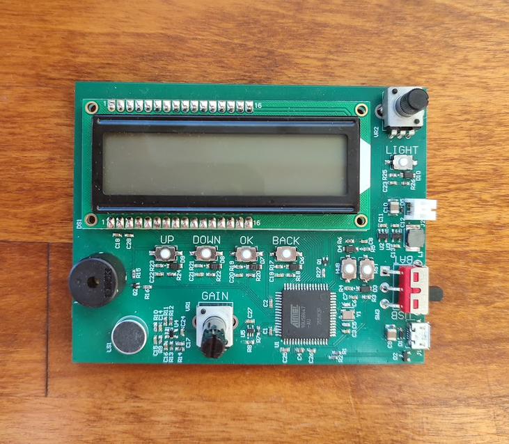
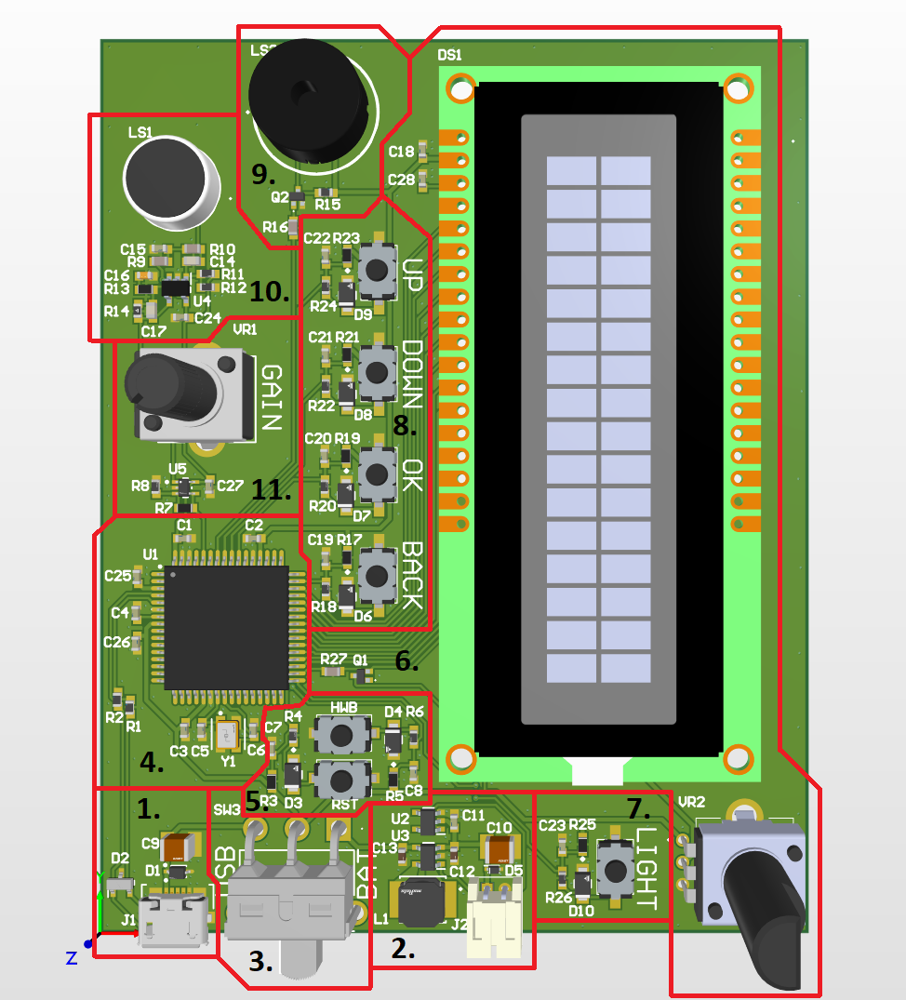
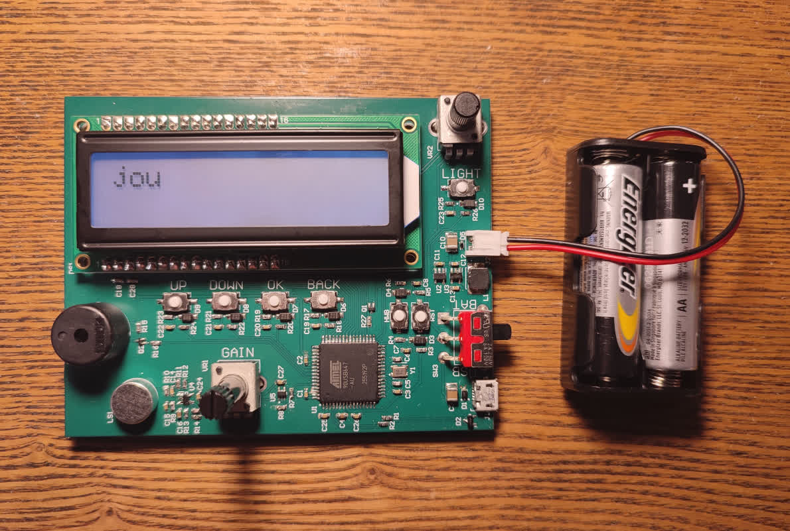
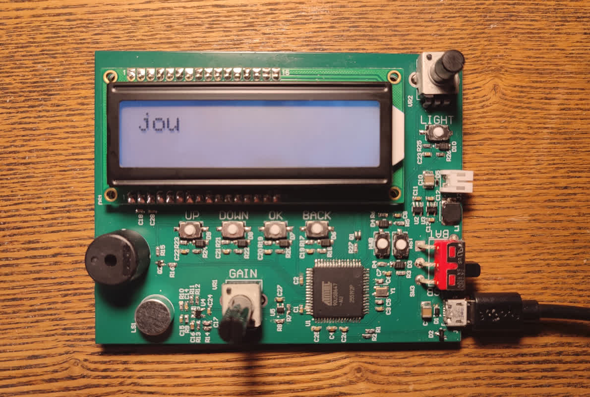
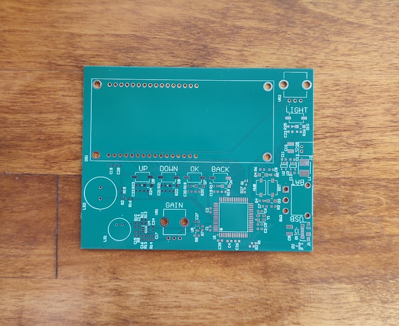

# Pitch-Identifier

> ### State of the project: failed, subject to revision

The purpose of this device is to help identify which musical notes are currently being played.
It should identify the most prevalent frequencies in the range of ~50-1000 Hz (which roughly corresponds to musical notes from C2 to C6).
Harmonics are also taken into consideration to identify which note (or notes) are currently being played. 
Once notes are identified, it can tell which harmonies they belong in.
It also has a buzzer so it could play notes back.
The current version of the project does not work because I couldn't get a critical component and failed to filter and amplify the signal from the microphone.
The revised version is [here](https://github.com/k3idi/Pitch-Identifier-Revised).

### Sections of the PCB

The design schematic and PCB files can be found [here](https://github.com/k3idi/Pitch-Identifier/tree/main/PCB%20design%20files).

#### 1. USB power and programming interface

One of the ways to power the device is through the USB Micro B receptable (J1).
This is primaraly used when programming the device, but it can also be used as an alternative when batteries are unavailable.
There is an ESD protection diode on the power line (D1) and on the data lines (D2).
There is also a decoupling capacitor (C9) on the power line to keep the supply steady in case of current surges. (?)

#### 2. Battery power

The second way to power the device is from two AA batteries, which can be connected to J2.
There is an ESD protection diode (D5) and a decoupling capacitor (C10) on the power line.
Since two AA batteries in series output a voltage in the range of 2.0-2.6 V and my components expect 5 V, then there was a need for a voltage regulator (U3).
The voltage regulator has two decoupling capacitors, one for the input (C12) and one for output voltage (C13).
It also has an external inductor (L1).
Because batteries drain when used, then there is a supervisory circuit (U2) that disables the volatge regulator when the voltage from the batteries drops below 2 V.
There is a decoupling capacitor on the circuit's supply pin (C11).

#### 3. Power switch

This switch (SW3) has three states and is used to choose between power sources.
If the switch is in the first position, then the device is supplied by USB.
If it is in the second position, then the power line is disconnected form either source.
In the third position, it is supplied by two AA batteries.

Battery-powered             |  USB-powered
:-------------------------:|:-------------------------:
  |  

#### 4. Microcontroller

I chose Atmel's (?) AT90USB647 as the microcontroller (U1), because I had some left over from a previous project, it has a built-in ADC and because it can be programmed over USB without having to flash a bootloader on it (?).
There are four decoupling capacitors on its supply voltage pins (C1-C3, C25, C26) and one for the USB's internal voltage regulator (C4).
There are resistors (R1, R2) on both the USB's data lines, as was mandated by Big USB (?).
The MCU also has an external 16 MHz crystal oscillator (Y1) with its load capacitors (C5, C6), to maintain an accurate and fast clock signal.

#### 5. Reset and HWB buttons

These buttons are mainly used when programming the device, though the reset button (RST) can be used to restart the code as well.
The buttons have an ESD diode (D3, D4), anti-debounce capacitors (C7, C8) and resistors for voltage division and current limiting (R3-R6).

#### 6. LCD

The LCD (DS1) has a white backlight, though its text can also be deciphered with the backlight off.
To control the contrast of the text, there is a potentiometer (VR2) that is used as a voltage divider for the V0 pin of the LCD.
The brightness of the backlight can be gradually increased by changing the duty cycle of the PWM signal that rapidly connects are disconnects the LCD's cathode (?) to and from ground.
To achieve this there is an NPN transistor (Q1) and a resistor (R27) to reduce the current to the NPN's base. (?)

#### 7. Light button

This button controls the intensity of the backlight.
It can either be fully off, in two intermediary stages or as bright as it can be.
The button has an ESD protection diode (D10) and an anti-debounce capacitor (C23).
To complete the button circuit there are also two resistors (R25, R26).

#### 8. Other user buttons

These buttons are for the user to control the device.
The *UP* and *DOWN* buttons are mainly to switch between options, the *OK* button is to choose something and the *BACK* button is to navigate back. (?)
All the buttons have an ESD protection diode (D6-D9), an anti-debounce capacitor (C19-C22) and resistors for voltage division and to limit current (R17-R24).

#### 9. Buzzer

This is a piezoelectric transducer buzzer (LS1) that plays a sound when it receives a square-wave signal with appropriate frequency.
The buzzer works because piezoelectric elements deform when a certain voltage is applied to its terminals and in the buzzer's case what distorts is similar to a speaker's diaphragm.
The curcuit also includes an NPN BJT (Q1) and two resistors (R7, R8), which make up the drive circuit for the buzzer.
When the MCU pin connected to the BJT's base is high, then the base-emitter junction becomes forward-biased, allowing current to flow from the collector to the emitter, which is connected to ground, and the buzzer is charged. 
When the MCU pin connected to the BJT's base is low, then the buzzer is no longer connected to ground and it gets discharged through R7. 

#### 10. Microphone and preamplification

To convert sound waves into electrical signals, the device features an electret microphone capsule (LS1).
Because the signal output by the microphone is of low amplitude and noisy, then it needs to be filtered and amplified before it is sampled by the ADC.
The circuit is designed after the typical application circuit shown in the preamplifier's (U4, MAX4466) [datasheet (page 8)](https://www.mouser.ee/datasheet/3/1014/1/MAX4465-MAX4469.pdf).
The polarization of the mic is achieved through R9 and R10 with C15 providing stability.
The capacitor C14 is there a a high-pass filter that blocks the DC component.
The resistors R11 and R12 make sure the signal is centered around Vdd/2.
The resistors R13 and R14 determine the gain of the amplifier.
They are also part of the amplifier's bandpass filter with C16 and C17.
Sadly, I couldn't get the MAX4466 component, because it only ships to business clients.
I tried replacing it with an op-amp [LMV931MGX/NOPB](https://www.ti.com/lit/ds/symlink/lmv931-n.pdf?ts=1791908925832), but I couldn't get the amplification to work.
The signal was just very noisy and its amplitude was less than 20 mV (which is at least 10 times less than the expected amplificaiton).

#### 11. Secondary amplification

In order to control the mic's amplification, there is a potentiometer (VR1) that acts as a voltage divider.
It can reduce the amplitude of the first amplification stage's output.
After this comes the secondary amplififcation, which is achieved using a non-inverting amplifier.
This circuit includes an op-amp (U5), resistors for voltage division (R7, R8) and a decoupling capacitor on its Vdd pin (C27).
I implemented this amplification stage wrong.
Instead of amplifying the amplitude of the signal, it amplifies it from 0V as you would a DC signal.
However, the output of this stage could have been suitable for the ADC, had the previous amplification stage worked.

### Photos of the board

Unsoldered             |  Soldered
:-------------------------:|:-------------------------:
  |  

### Mistakes and fixes

The most obvious mistake is that I couldn't get a signal from the microphone.
Even when directly measuring the microphone's raw output, then it did not seem to be affected by sound at all.
I tried constructing a different microphone amplification circuit on a breadboard as well, but I could not get that to work either.
However, that might be because I used an unsuitable op-amp. 
I'm quite distraught that I haven't been able to amplify the signal, becaue at this point I don't know where the issue lies.
Anyway, I want to try again to get at least some amplification to work, but I need to get a hold of a few components in order to do that.

A big mistake I made when designing the board was that I connected the AREF pin of the MCU to ground. 
The AREF pin can be used to provide an external reference voltage for the succesive approximation ADC.
I was planning to use the internal 2.56V reference, so in that sense it didn't seem like an issue that AREF was connected to ground.
However, what I hadn't noticed before, was that when using the 2.56V internal reference voltage, then AREF had to either be left floating or connected to ground though a capacitor (for example 100 nF) to reduce noise.
Connecting it to ground would have resulted in a short-circuit if any other reference voltages would be used instead of the external AREF voltage.
Luckily, I noticed the mistake before I configured and enabled the ADC (I did break the ADC of a different PCB, though).
I was able to cut the ground plane around the AREF pin, thus leaving the pin floating.
I was going to solder a THT capacitor to it if the ADC's reference voltage was noisy, but since I couldn't get the microphone circuit to work then this effort would have been futile.

